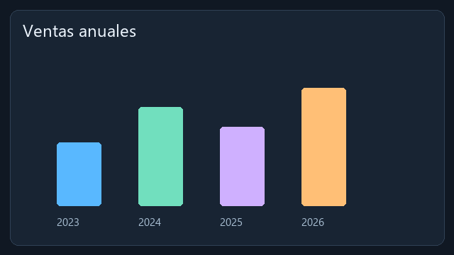

# AK Screen · Biblioteca

[**Explorar catálogo web →**](https://edgajuman.github.io/AKScreen-Assets/) · [Descargar AK Screen](https://github.com/Edgajuman/AKScreen-Downloads/releases)

## Colecciones de edgajuman para 2.4.0

- **Motion Essentials:** título con capas editables, tres transiciones, corrección, filtro y animación.
- **Data Stories:** seis gráficos de datos animados y editables.
- **Sound & Surfaces:** Essential Sound, fondo, GIF, sonido original y LUT.
- **Loop Studies:** clip original de barras animadas, MP4 H.264, 640 × 360 y 30 FPS.

Son **20 recursos en cuatro colecciones**, publicados por edgajuman con licencia CC0-1.0.

Dentro del editor: **Herramientas → Biblioteca comunitaria → Actualizar catálogo**. Descarga un recurso o el paquete completo; aparece en **Effects → Biblioteca · Descargas**. Las imágenes del catálogo son ilustraciones originales; las capturas reales del editor están en el repositorio de descargas.

Biblioteca comunitaria de recursos aprobados para AK Screen: medios pequeños, plantillas de títulos,
presets de efectos, transiciones, filtros, LUT y animaciones. Los paquetes pueden agrupar recursos de
un mismo tema —por ejemplo, una colección de fútbol— o publicar uno solo.

**Los usuarios pueden explorar y descargar sin iniciar sesión.** AK Screen consulta el catálogo
estático [`catalogue.json`](catalogue.json) y verifica el tamaño y el SHA-256 de cada recurso antes de
guardarlo. Los aportes entran mediante pull request y solo se muestran tras su revisión y fusión.

## Para publicar

Lee [CONTRIBUTING.md](CONTRIBUTING.md). Desde **AK Screen 3.0**, abre **Herramientas →
Biblioteca comunitaria → Preparar aporte → Iniciar sesión con GitHub**. Introduce el
código temporal en GitHub con tu propia cuenta. El editor prepara tu fork, una rama
y un pull request para revisión; no modifica directamente el catálogo oficial.

La autorización OAuth solicita `public_repo` para escribir en tu fork público y
enviar el PR. El token personal se conserva en el almacén de credenciales del
sistema; puedes desconectarlo desde el editor. No se requiere instalar la GitHub
App anterior y no se distribuye una cuenta ni un token compartidos.

Puedes guardar borradores locales, continuar después, crear otra versión de un
aporte y consultar si el PR está en revisión, aceptado o cerrado sin aceptar.
También puedes seguir el flujo manual de fork y pull request. Nunca añadas
credenciales, ejecutables, scripts ni código de plugins.

## Formatos aceptados

| Tipo | Archivos |
|---|---|
| Vídeo | MP4, WebM, MOV, MKV |
| Audio | WAV, MP3, FLAC, OGG |
| Imagen | PNG, JPEG, WebP, GIF |
| Título / Essential Graphics | `.fcgt` propio de AK Screen |
| Essential Sound | JSON `akscreen.essential-sound` |
| Gráfico de datos | `.akchart` con datos y apariencia |
| Preset de efecto, transición, filtro o animación | JSON de presets compatibles |
| LUT | `.cube` |

Un preset modifica parámetros de capacidades que ya existen en la aplicación. Este repositorio no
distribuye extensiones ni código ejecutable; esos componentes usan su catálogo separado y su modelo
de revisión/permisos.

## Licencias y tamaño

Cada recurso declara atribución, procedencia y licencia en `pack.json`. Se admiten CC0-1.0,
CC-BY-4.0, CC-BY-SA-4.0, MIT, Apache-2.0, BSD-3-Clause, ISC y OFL-1.1. El autor debe tener derecho a
redistribuir el archivo y sus recursos incluidos.

El límite es 50 MB por archivo y 250 MB por paquete. Los vídeos de mayor tamaño deben adjuntarse a una
GitHub Release tras su aprobación; no uses Git LFS para colecciones descargadas por mucha gente porque
su cuota de transferencia pertenece al propietario del repositorio. Si el tráfico crece, el catálogo
puede seguir en este repositorio y los binarios grandes migrar a un CDN u objeto público.

## Seguridad y privacidad

El contenido se sirve desde GitHub Raw bajo HTTPS; la aplicación limita tamaños, rutas y extensiones,
verifica hashes y solo pasa a sus importadores formatos de datos conocidos. GitHub Actions valida cada
pull request. El editor no ejecuta el contenido de este repositorio ni envía proyectos, clips o datos
personales. La licencia y autoría de cada recurso se conservan en su manifiesto.

La biblioteca y el catálogo son públicos. No se requiere token para descargar o actualizar. Nunca
subas un PAT, contraseña, clave privada ni API key a este repositorio.
